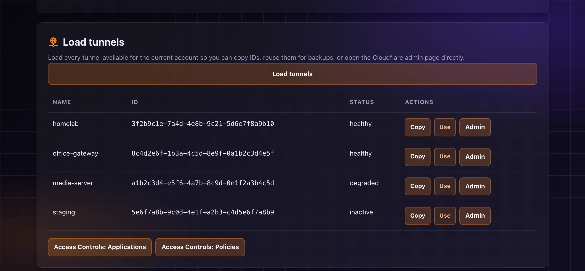

# Tikka Masala

Tikka Masala is a small FastAPI web app for backing up and restoring Cloudflare Tunnel configurations. It gives you a simple UI to list available tunnels, save JSON snapshots locally, and restore a saved configuration later.

Website: <https://tikkamasala.gioxx.org>

[](https://github.com/gioxx/TikkaMasala/issues)
[](https://github.com/gioxx/TikkaMasala/pulls)


[](https://hub.docker.com/r/gfsolone/tikkamasala)
[](https://hub.docker.com/r/gfsolone/tikkamasala)



## Table of Contents

- [Features](#features)
- [Requirements](#requirements)
- [Environment Variables](#environment-variables)
- [Run with Docker Compose](#run-with-docker-compose)
- [Run with Docker Only](#run-with-docker-only)
- [Run Without Docker](#run-without-docker)
- [First Run and Credentials](#first-run-and-credentials)
- [Navigation](#navigation)
- [Storage Layout](#storage-layout)
- [What Gets Backed Up](#what-gets-backed-up)
- [Restore Behavior](#restore-behavior)
- [Automatic Backups](#automatic-backups)
- [Notifications](#notifications)
- [Demo Mode](#demo-mode)
- [Cloudflare Access](#cloudflare-access)
- [Upgrading](#upgrading)
- [Security Notes](#security-notes)
- [Project Notes](#project-notes)
- [Credits](#credits)

## Features

- Enter your Account ID and API token once on a first-run setup screen; they are checked against Cloudflare before they are saved
- **Tunnels** home: summary tiles (status, hostname count, last backup, saved backups) and a live table of every tunnel in the account, with a per-row **Back up** button and a **Back up all now** button
- Open each tunnel's page in the Cloudflare dashboard (Networking → Tunnels) straight from the tunnel list
- Quick-access links to Cloudflare Access Controls (Applications and Policies) below the tunnel table
- Create JSON backups of one tunnel or of all tunnels at once
- Download saved snapshots
- See every ingress rule of a snapshot (hostname, path, origin `service`, `originRequest` settings), with host-local origins such as `localhost` flagged
- Restore a snapshot to the original tunnel or to another tunnel
- Preview a restore as an ingress diff against the tunnel's live configuration before applying it
- See every public hostname of every tunnel and the origin it points to on one **Hostnames** page (`/ingress`): read from the latest snapshot of each tunnel, or live from the Cloudflare API, with filtering and warnings for host-local origins and hostnames served by more than one tunnel
- Keep local metadata in SQLite
- Track restore history per backup
- Manage the saved credentials on a **Settings** page (token masked, replace, forget) without deleting backups
- Switch between system, dark, and light theme
- Schedule automatic backups for all tunnels or a selected subset of tunnels in the account
- Set per-tunnel backup frequency (every run, once per week, once per month)
- Send notifications through a generic webhook and/or Telegram
- Customize the notification message for each event with plain text and dynamic placeholders
- Run in demo mode without persisting authentication data, scheduler state, or notifications

## Requirements

- Docker and Docker Compose, or
- Python 3.12 if you want to run the app directly
- A Cloudflare API token with permissions suitable for Cloudflare Tunnel configuration changes

Recommended token permissions:

- `Account: Cloudflare Tunnel -> Edit`
- `Zone: DNS -> Edit`

For backup-only usage, you can later reduce the token to read-only permissions if your workflow allows it.

## Environment Variables

You can configure the app through environment variables, whether you use Docker Compose, `docker run`, Portainer, or a direct shell session.

| Variable | Required | Description |
| --- | --- | --- |
| `CLOUDFLARE_ACCOUNT_ID` | No | Account ID of the Default profile. With both this and `CLOUDFLARE_API_TOKEN` set, the first-run setup is skipped and Settings shows them read-only. |
| `CLOUDFLARE_API_TOKEN` | No | API token of the Default profile. See `CLOUDFLARE_ACCOUNT_ID`. |
| `TOKEN_ENCRYPTION_KEY` | No | Fernet key used to encrypt the saved API token. If unset, the app generates one as `DATA_DIR/encryption.key` (mode `0600`). Set it only if you want to manage the key yourself, or keep an existing one. |
| `CF_ACCESS_TEAM_DOMAIN` | No | Cloudflare Zero Trust team domain, e.g. `yourteam.cloudflareaccess.com` (or just `yourteam`). Set together with `CF_ACCESS_AUD` to require a valid Cloudflare Access login on every request. See [Cloudflare Access](#cloudflare-access). |
| `CF_ACCESS_AUD` | No | Application Audience (AUD) tag of the Access application that protects Tikka Masala. Set together with `CF_ACCESS_TEAM_DOMAIN`. |
| `AUTO_BACKUP_TIMEZONE` | No | Force automatic backups to use a specific IANA timezone such as `Europe/Rome`. |
| `BACKUP_RETENTION_DAYS` | No | Automatically delete backups older than this many days after new backups are created. |
| `NOTIFICATION_WEBHOOK_URL` | No | Send JSON notifications to a generic webhook endpoint. |
| `NOTIFICATION_WEBHOOK_EVENTS` | No | Comma-separated list of notification events to emit to the webhook. |
| `TELEGRAM_BOT_TOKEN` | No | Telegram bot token used to send notifications through the Bot API. |
| `TELEGRAM_CHAT_ID` | No | Telegram chat, group, or channel ID where notifications should be sent. |
| `TELEGRAM_NOTIFICATION_EVENTS` | No | Comma-separated list of notification events to emit to Telegram. |
| `DATA_DIR` | No | Storage path for the SQLite database and JSON backups. Default: `/data`. |
| `REQUEST_TIMEOUT` | No | Outbound Cloudflare API timeout in seconds. Default: `20`. |
| `LOG_LEVEL` | No | Application log level written to container stdout. Default: `INFO`. |
| `CLOUDFLARE_API_BASE` | No | Override for the Cloudflare API base URL. Default: `https://api.cloudflare.com/client/v4`. |
| `DEMO` | No | Enable demo mode. Defaults to `false`. Demo mode disables persistence, automatic backups, notifications, and the backup archive. |

Start from [`.env.sample`](.env.sample):

```bash
cp .env.sample .env
```

`TOKEN_ENCRYPTION_KEY` is optional. If you prefer to manage the key yourself, generate a Fernet key with:

```bash
python3 -c "from cryptography.fernet import Fernet; print(Fernet.generate_key().decode())"
```

## Run with Docker Compose

The included [`docker-compose.yml`](docker-compose.yml) mounts `./data` into the container so backups and settings survive restarts.

```bash
docker compose up -d --build
```

Then open:

```text
http://localhost:8080
```

Example `.env` for Compose:

```env
CLOUDFLARE_ACCOUNT_ID=your-32-char-account-id
CLOUDFLARE_API_TOKEN=your-cloudflare-api-token
# TOKEN_ENCRYPTION_KEY=your-generated-fernet-key   # optional
AUTO_BACKUP_TIMEZONE=Europe/Rome
BACKUP_RETENTION_DAYS=90
NOTIFICATION_WEBHOOK_URL=
NOTIFICATION_WEBHOOK_EVENTS=auto_backup_success,auto_backup_partial,auto_backup_failed,restore_failed,retention_cleanup
TELEGRAM_BOT_TOKEN=
TELEGRAM_CHAT_ID=
TELEGRAM_NOTIFICATION_EVENTS=auto_backup_success,auto_backup_partial,auto_backup_failed,restore_failed,retention_cleanup
LOG_LEVEL=INFO
DEMO=false
```

## Run with Docker Only

```bash
docker build -t tikkamasala .
docker run -d \
  --name tikkamasala \
  --restart unless-stopped \
  --env-file .env \
  -p 8080:8080 \
  -v "$(pwd)/data:/data" \
  tikkamasala
```

## Run Without Docker

```bash
python3 -m venv .venv
source .venv/bin/activate
pip install -r requirements.txt
set -a
source .env
set +a
uvicorn app.main:app --host 0.0.0.0 --port 8080
```

## First Run and Credentials

If `CLOUDFLARE_ACCOUNT_ID` and `CLOUDFLARE_API_TOKEN` are both set in the environment, there is nothing to configure: setup is skipped and the app uses them.

Otherwise the first page you open is a **setup screen** (`/setup`). Enter your Account ID and an API token; the app checks them against Cloudflare (token verification and a tunnel listing) and saves them only if the check passes. The token is stored encrypted in `app.db` and is never shown again in clear.

After setup, credentials are managed on the **Settings** page (`/settings`):

- the Account ID is shown in clear, the token as "configured, ending in XXXX"
- **Replace credentials** validates the new values before saving them
- **Forget saved credentials** removes the saved Account ID and token from the database; backups are kept. Values from the environment stay in place
- Settings also shows the Cloudflare Access status, the app version, and where the encryption key comes from

Precedence is per field: the saved database value first, then the environment. If a value comes from the environment, Settings shows it read-only with a **Save a different value** option, which stores your value in the database and takes precedence from then on.

Every page, the scheduler and restore use these saved server-side credentials; no credentials live in the browser. Restoring a backup uses the credentials of the profile that owns the backup's account.

Upgrading from a version that kept the token in a browser cookie: the first request that still carries the cookie saves the token into the database (when none is saved yet) and then deletes the cookie. Nothing needs to be re-entered. When `CLOUDFLARE_API_TOKEN` is set, the cookie is only deleted: the environment token keeps being used.

If the saved token cannot be decrypted (for example `encryption.key` was removed), the app sends you back to the setup screen, which explains it; saving a new token replaces the unreadable one.

### Finding your Account ID and creating a token

The **Account ID** is on the **Account home** page of the [Cloudflare dashboard](https://dash.cloudflare.com/): use **Copy account ID** in the account menu.

Create a custom API token in the [API tokens page](https://dash.cloudflare.com/profile/api-tokens) with:

- **Account**: Cloudflare Tunnel - Edit
- **Zone**: DNS - Edit

For backup-only usage, you can reduce the token to read-only permissions later.

## Navigation

A top bar gives access to five sections (it collapses to a menu button below 960px):

- **Tunnels** (`/`): the home page. Summary tiles, the live tunnel table, per-row **Back up** and **Back up all now**
- **Hostnames** (`/ingress`): every public hostname of every tunnel and its origin
- **Backups** (`/backups`): the saved backups with archive statistics and retention (interim page, to be redesigned)
- **Automation** (`/automation`): the scheduler, notification channels and message customization (interim page, to be redesigned)
- **Settings** (`/settings`): credentials, Cloudflare Access status and version

## Storage Layout

Everything is stored under `DATA_DIR`, which defaults to `/data` in the container and typically maps to `./data` on the host.

- `app.db`: SQLite database for backup metadata, restore history, and saved credentials (the token is encrypted)
- `encryption.key`: Fernet key generated on first use when `TOKEN_ENCRYPTION_KEY` is not set (mode `0600`). Keep it: without it the saved token cannot be read
- `backups/*.json`: exported tunnel configuration snapshots
- `app.db.pre-v1.bak`: copy of the database taken before the profiles migration (see [Upgrading](#upgrading))

Trade-off: with the generated key, a copy of `DATA_DIR` contains both the encrypted token and the key that decrypts it. If you back up or share that directory, set `TOKEN_ENCRYPTION_KEY` in the environment instead, so the key lives elsewhere.

## What Gets Backed Up

Tikka Masala saves the tunnel configuration returned by the Cloudflare Tunnel configuration endpoints, along with backup metadata such as:

- export timestamp
- account ID
- tunnel ID
- tunnel name
- notes

It does not back up arbitrary account-wide Cloudflare settings.

## Restore Behavior

Restoring a backup replaces the current remote configuration of the selected tunnel with the configuration stored in the snapshot.

The backup detail page keeps a restore history so you can see:

- when a backup was restored
- which account it was restored to
- which tunnel it was restored to
- whether the restore targeted the original tunnel, a different tunnel, or a different account

### Origin addresses and containers

Each ingress rule carries an origin `service` such as `http://localhost:3000`. `localhost` (and `127.0.0.0/8`) is resolved relative to wherever `cloudflared` runs. When `cloudflared` runs in a container, `localhost` is the container, not the Docker host, so a rule pointing there returns `502` while rules that use `host.docker.internal`, the bridge gateway IP, or a service name keep working.

The backup detail page lists every ingress rule with its origin address and highlights host-local origins. Use **Preview changes** on the restore form to see which ingress rules a snapshot would add, remove, or change against the live tunnel configuration before applying it.

## Automatic Backups

Tikka Masala can schedule recurring backups for tunnels visible in the configured account.

The scheduler is built into the app and stores its configuration in the local SQLite database. From the **Automation** page you can:

- enable or disable automatic backups
- set a cron expression
- run the job immediately with `Run now`
- see the last run, next run, and recent execution history
- open the **Advanced schedule** page to control which tunnels are backed up and how often

By default, automatic backups use the timezone detected from the browser when you save the schedule. If you want a fixed server-side timezone for all users, set `AUTO_BACKUP_TIMEZONE`.

### Advanced schedule

The **Advanced schedule** page (`/auto-backup/tunnel-filters`) lets you control backup scope and per-tunnel frequency:

**Backup mode:**

- **All tunnels** (default): every tunnel in the account is backed up on each run. You can still throttle individual tunnels with a frequency override.
- **Selected tunnels only**: only the tunnels you explicitly check are included in each run.

**Frequency overrides (per tunnel):**

- **Every run**: backed up on every scheduled or manual run (default).
- **Once per week**: skipped if a backup for that tunnel already exists within the last 7 days.
- **Once per month**: skipped if a backup for that tunnel already exists within the last 30 days.

This lets you, for example, run the scheduler daily but back up low-priority tunnels only once a week.

Important notes:

- automatic backups use the saved credentials (database, then environment)
- each run creates normal backups, so automatic and manual backups share the same archive
- if `BACKUP_RETENTION_DAYS` is set, old backup files and related database records are deleted automatically after new backups are created
- retention cleanup removes both the JSON snapshot and its related restore history
- container logs include both Uvicorn access logs and application logs for startup, backup creation, restore, scheduler activity, cleanup, and most UI-triggered operations

## Notifications

Tikka Masala can send server-side notifications through:

- a generic webhook endpoint
- Telegram

You can use either channel on its own or enable both at the same time.

Set:

- `NOTIFICATION_WEBHOOK_URL` to the target endpoint
- `NOTIFICATION_WEBHOOK_EVENTS` to a comma-separated list of events
- `TELEGRAM_BOT_TOKEN` to your Telegram bot token
- `TELEGRAM_CHAT_ID` to the destination chat ID
- `TELEGRAM_NOTIFICATION_EVENTS` to a comma-separated list of events

Supported events:

- `notification_test`
- `manual_backup_success`
- `manual_backup_failed`
- `auto_backup_success`
- `auto_backup_partial`
- `auto_backup_failed`
- `restore_success`
- `restore_failed`
- `retention_cleanup`

If `NOTIFICATION_WEBHOOK_EVENTS` or `TELEGRAM_NOTIFICATION_EVENTS` is left empty, Tikka Masala enables the default event set for that channel:

- `auto_backup_success`
- `auto_backup_partial`
- `auto_backup_failed`
- `restore_failed`
- `retention_cleanup`

Webhook notifications send a JSON payload with:

- app name and version
- event name
- message
- timestamp
- event-specific details

Telegram notifications send the same information as a formatted plain-text message through the Telegram Bot API. By default Telegram messages are compact (title and message only); toggle **Compact Telegram notifications** off on the **Customize notification messages** page to also append the structured `key: value` details block (trigger, account_id, tunnel counts, skipped tunnels, etc.). The webhook channel is unaffected either way and always receives the full payload.

When notifications are configured:

- container logs show the active channels and event counts at startup
- the **Automation** page shows a dedicated `Notifications` box with channel and event counts
- **Back up all now** sends one `manual_backup_*` notification per tunnel, like the per-row **Back up**
- you can use `Send test notification` from the UI to verify webhook and/or Telegram delivery immediately
- the test notification uses the `notification_test` event
- notification results are shown directly inside the section that triggered them instead of at the top of the page

### Customizing notification messages

Each event has a built-in default message. You can override it from the **Customize notification messages** page (`/notifications/messages`).

Messages support `{placeholder}` tokens that are replaced at runtime with event-specific values. Two tokens are always available regardless of the event:

- `{version}` — current app version
- `{timestamp}` — ISO 8601 UTC timestamp of the notification

Available tokens per event:

| Event | Available tokens |
|---|---|
| `notification_test` | _(none specific)_ |
| `manual_backup_success` | `{backup_id}`, `{account_id}`, `{tunnel_id}`, `{tunnel_name}`, `{route_count}` |
| `manual_backup_failed` | `{account_id}`, `{tunnel_id}`, `{error}` |
| `auto_backup_success` | `{trigger}`, `{account_id}`, `{tunnel_count}`, `{backup_count}`, `{error_count}`, `{skipped_count}`, `{processed_count}`, `{backed_up_tunnels}`, `{skipped_tunnels}` |
| `auto_backup_partial` | `{trigger}`, `{account_id}`, `{tunnel_count}`, `{backup_count}`, `{error_count}`, `{skipped_count}`, `{processed_count}`, `{backed_up_tunnels}`, `{skipped_tunnels}` |
| `auto_backup_failed` | `{trigger}`, `{account_id}`, `{tunnel_count}`, `{backup_count}`, `{error_count}`, `{skipped_count}`, `{processed_count}`, `{backed_up_tunnels}`, `{skipped_tunnels}` |
| `restore_success` | `{backup_id}`, `{account_id}`, `{tunnel_id}` |
| `restore_failed` | `{backup_id}`, `{account_id}`, `{tunnel_id}`, `{error}` |
| `retention_cleanup` | `{deleted_count}`, `{retention_days}`, `{cutoff}` |

For `auto_backup_*` events:

- `{tunnel_count}` — total tunnels discovered on the account
- `{processed_count}` — tunnels the run actually attempted (`backup_count` + `error_count`)
- `{skipped_count}` — tunnels skipped by per-tunnel scheduling rules (not selected, weekly/monthly cooldown)
- `{backed_up_tunnels}` — comma-separated list of tunnel names that were backed up (or `—` if none)
- `{skipped_tunnels}` — comma-separated list of skipped tunnel names with the reason in parentheses (or `—` if none)

Leaving a field empty restores the built-in default for that event. Unknown tokens are left as-is in the output.

> **Note:** as of 1.3.4, the default `auto_backup_*` messages include the new tokens above. If you had already saved a custom message, clear the field (or click *Use default*) on the notification customization page to pick up the new format.

> **Note:** as of 1.3.5, Telegram notifications are compact by default (title and message only, no details block). Uncheck **Compact Telegram notifications** on the same page if you relied on the previous, more verbose format.

## Demo Mode

Set `DEMO=true` when you want to exercise the UI without persisting auth data or enabling server-side automation.

In demo mode:

- credentials come only from the environment: there is no setup screen, Settings is read-only, and without environment credentials the app shows "No credentials in demo mode"
- nothing is written to SQLite and no encryption key file is created
- automatic backups are disabled
- notifications are disabled
- the backup archive is disabled

Only the **Tunnels** and **Settings** sections are available. The per-row **Back up** button downloads the tunnel's JSON; there is no **Back up all now**.

## Cloudflare Access

If you publish Tikka Masala through a Cloudflare Tunnel, you can protect it with a Cloudflare Access application (Zero Trust → Access → Applications). Access handles the login (Google, GitHub, one-time PIN by email, and so on); Tikka Masala has no accounts or passwords of its own.

By default the app trusts whoever reaches it. Set both variables below and it also verifies, on every request, the signed token that Cloudflare Access adds (`Cf-Access-Jwt-Assertion` header). Requests without a valid token get a `403` page, so nobody can get in by reaching the container around Access (LAN IP and port, another proxy).

| Variable | Where to find it |
| --- | --- |
| `CF_ACCESS_TEAM_DOMAIN` | Zero Trust dashboard → Settings, under your team name and domain, e.g. `yourteam.cloudflareaccess.com`. `yourteam` alone also works. |
| `CF_ACCESS_AUD` | Zero Trust → Access → Applications → your application → Overview → Application Audience (AUD) Tag. |

Neither value is a secret. Setting only one of them stops the app at startup with an explicit error, so a half-finished configuration never runs unprotected.

Things to know:

- A **Bypass** policy on the application skips Access entirely, so Cloudflare sends no token and the app answers `403`. Use Allow policies (and log in) for everyone who should reach Tikka Masala.
- `/healthz` is never checked, so the Docker healthcheck keeps working.
- The signed-in email (or "service token") and a **Sign out** link appear in the page header.
- Rejected requests are logged with the client address and the reason, never with the token.

## Upgrading

On the first start after upgrading to a version with profiles, the app migrates the saved Account ID, API token and automatic backup settings from the global settings into a profile named "Default". Existing backups and schedule history are kept, and the UI behaves as before.

Before migrating a database that already has data, the app copies it to `app.db.pre-v1.bak` in `DATA_DIR` (readable only by its owner). A database written by a newer version makes the app refuse to start.

The `.bak` is written only if the database already had data (fresh installs have none), and only while the migration has not completed yet. A failed migration leaves the database untouched, so the next attempt replaces the `.bak` with a fresh copy that includes anything written in between. Once the migration succeeds, the file is never written again. Keep it until you are satisfied with the new version.

To roll back:

1. Stop the container.
2. Optionally copy `backups/` aside: restoring loses the database rows for backups, restores and automatic backup runs created after the upgrade. Their JSON files stay in `backups/` but are no longer listed.
3. Restore `app.db.pre-v1.bak` as `app.db` in `DATA_DIR`.
4. Start the exact image tag you ran before (check `docker-compose.yml` or `docker image ls`). If you ran `:latest`, pin the last release before profiles; check the release notes or tags.

Credentials and the encryption key:

- a token still held in the old browser cookie is migrated into the database once, then the cookie is deleted (with `CLOUDFLARE_API_TOKEN` set, nothing is migrated and the cookie is just deleted)
- if `TOKEN_ENCRYPTION_KEY` is unset, a key is generated as `DATA_DIR/encryption.key` the first time one is needed; an existing `TOKEN_ENCRYPTION_KEY` keeps working unchanged
- before downgrading to an older version, set `TOKEN_ENCRYPTION_KEY` to the content of `encryption.key`; otherwise the older version cannot read the saved token

Running a previous image on the migrated database without restoring `app.db.pre-v1.bak` is not supported: the older version finds no saved credentials or schedule, so the automatic schedule silently stops (values from environment variables still work). Restoring the file is required to downgrade.

## Security Notes

- The API token is never persisted in plaintext in the database and is never shown in the UI after it is saved; the browser never holds it.
- The encryption key comes from `TOKEN_ENCRYPTION_KEY` or, if unset, from `DATA_DIR/encryption.key` (mode `0600`, never overwritten). A copy of `DATA_DIR` holds both the database and that key.
- Credentials are validated against Cloudflare before they are saved, and the Account ID must be 32 hex characters.
- Requests that change data (any method other than GET, HEAD or OPTIONS) are rejected when the browser marks them as cross-site.
- When `CF_ACCESS_TEAM_DOMAIN` and `CF_ACCESS_AUD` are set, every request except `/healthz` must carry a valid Cloudflare Access token. See [Cloudflare Access](#cloudflare-access).
- Older plaintext tokens already present in the database are upgraded to encrypted form the first time they are read successfully.

## Project Notes

- Application entrypoint (app wiring, routers, lifecycle): [`app/main.py`](app/main.py)
- Domain modules: [`config.py`](app/config.py) (environment), [`db.py`](app/db.py) (SQLite schema and settings), [`credentials.py`](app/credentials.py) (Account ID / token handling), [`encryption.py`](app/encryption.py) (key and secret encryption), [`setup.py`](app/setup.py) (first-run setup), [`cloudflare.py`](app/cloudflare.py) (API client), [`backups.py`](app/backups.py) (snapshots and retention), [`scheduler.py`](app/scheduler.py) (automatic backups), [`notifications.py`](app/notifications.py) (webhook / Telegram), [`ingress.py`](app/ingress.py) (ingress parsing and diff), [`web.py`](app/web.py) (templates and page renderers)
- HTTP routes: [`app/routers/`](app/routers)
- Hostnames overview: [`app/ingress_overview.py`](app/ingress_overview.py); live refresh uses [htmx](https://htmx.org) 2.0.4, vendored in [`app/static/vendor/`](app/static/vendor) (0BSD license)
- Templates extend [`app/templates/base.html`](app/templates/base.html) (head, top navigation, footer); shared page behaviour lives in [`app/static/app.js`](app/static/app.js)
- Page templates: [`tunnels.html`](app/templates/tunnels.html), [`backup.html`](app/templates/backup.html), [`scheduled_runs.html`](app/templates/scheduled_runs.html), [`tunnel_filters.html`](app/templates/tunnel_filters.html), [`notification_messages.html`](app/templates/notification_messages.html)
- Tests: `pip install -r requirements-dev.txt && pytest`

## Credits

- Icons: [Tabler Icons](https://tabler.io/icons)
